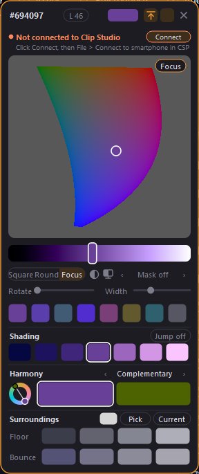

# Luma Picker

A floating color palette for digital painting on Windows, built around
**value**. Every color in the big field has the *same perceptual lightness*,
so you can change hue and saturation freely without breaking your values. It
also suggests shading colors, color harmonies and the shadow and bounce light
of an object's surroundings. Colors go straight into **Clip Studio Paint**.

## Features

- **Lightness-locked color field.** Pick any hue or saturation at one fixed
  value. The bar below changes the lightness. The grey around the colors is the
  neutral grey of the same value.
- **Two ways to measure value.** `L` (perceptual, OKLab) is the default. Click
  it to switch to `Y`, Clip Studio luminance: the grey you see when you check
  values with a grey layer in **Color** blend mode. Use `Y` if you check your
  values that way in Clip Studio.
- **Square or round.** Both show colors of one value only. The square is a
  grid of color blocks with hue running left to right, from pale at the top to
  the strongest color each hue can have at the bottom. On the round wheel the
  angle is the hue and the edge is the strongest color.
- **Gamut masks** (analogous, complementary, split complementary, triad) limit
  you to a few hue sectors that you can rotate and widen. Masked hues stay
  visible but dimmed. If you drag into one, the pick slides to the nearest
  allowed hue. If you load a color outside the mask (recent colors, eyedropper,
  swatches), the mask turns to cover it.
- **Mouse wheel** over the field or the bar nudges the value 1% per notch. The
  color goes to Clip Studio once you stop scrolling.
- **Shading** suggests 3 shadows and 3 lights for your color. Shadows get
  cooler, more saturated and darker. Lights get warmer, less saturated and
  lighter. Yellows darken through orange instead of turning green, and blues
  light up through cyan.
- **Harmony** offers complementary, split complementary, triad, square,
  tetradic and analogous schemes at the same lightness, with a mini color wheel.
- **Surroundings.** Pick the floor or background color and get:
  - **Floor:** the cast shadow, from the dark contact shadow under the object
    out to the soft edge.
  - **Bounce:** the surroundings reflected into the object's shadow side.
- **Eyedropper.** Pick any color on screen (canvas, references, Clip Studio's
  own color) into Luma, with the button or a hotkey.
- **Hex.** Click the hex code to copy it, or right-click it to paste one from
  the clipboard.
- **Floating panel.** Drag it by its top bar, pin it, keep it on top, or let it
  pop up under your pen with a hotkey. It works well on a macro pad
  (Razer Tartarus, Stream Deck, …).
- **Recent colors**, and settings that reload while the app runs.

## Download and install

1. Download `LumaPicker-<version>-windows.zip` from
   [Releases](../../releases/latest).
2. Unzip it anywhere, for example `Documents\Luma Picker`, and run
   **`Luma Picker.exe`**.
3. The panel opens and a rainbow ring icon appears in the system tray.

> **"Windows protected your PC"?** The app isn't code-signed yet, so
> SmartScreen warns about it. Click **More info → Run anyway**. You can check
> the source and build it yourself (see below).

## Connect to Clip Studio Paint (once)

Luma Picker sets Clip Studio's drawing color directly, over Clip Studio's
companion connection (the one its phone app uses).

1. Click **Connect** at the top of the Luma panel.
2. In Clip Studio open **File → Connect to smartphone**. Luma reads the QR code
   off your screen and connects. You can close the QR window after that.

Luma reconnects on its own every time both apps are running. Until it's
connected, the panel shows a warning and picks don't reach Clip Studio.

## Using it

| Do this | To |
|---|---|
| **Ctrl+Alt+Shift+C** | Show or hide the panel (under your pen, or at its pinned spot) |
| **Ctrl+Alt+Shift+E** | Eyedropper: click any color on screen to load it into Luma |
| Click or drag in the field, lift the pen | Send that color to Clip Studio |
| Drag the bar under the field | Change lightness |
| Mouse wheel over the field or bar | Nudge the value 1% per notch |
| **Square / Round / Focus** (under the bar) | Switch the field between the square view, a hue wheel and the color plane |
| **Focus / Full** (corner of the Focus view) | Zoom the plane to this value's colors, or show the whole plane |
| **‹ mask ›**, Rotate, Width | Pick a gamut mask, turn it and set how wide each sector is |
| Click **L / Y** next to the hex | Switch between perceptual and Clip Studio luminance value |
| Click a recent, shading or harmony swatch | Send that color |
| **Jump on/off** (Shading) | On: the wheel moves to the shade you picked. Off: the rows stay put |
| **‹ name ›** (Harmony) | Switch the harmony scheme |
| **Pick / Current** (Surroundings) | Set the surface color from the screen or from the current color |
| Click / right-click the **hex** | Copy it / paste a hex from the clipboard |
| Drag the top bar | Move the panel (it stays there and stays open) |
| Arrow-to-bar / pin / × (top right) | Stay in front of other windows / keep the panel open at its spot / hide |
| **Connect** (top of the panel) | Connect to Clip Studio, see above |
| Hover over any control | See what it does |
| Half circle (next to Square/Round) | Show the panel in greyscale. The field turns one flat grey |
| Half monitor, or **Ctrl+Alt+Shift+G** | Whole screen in greyscale to paint in values only. Press again for color. Picks still reach Clip Studio |

Map the two hotkeys to keys on your macro pad (for example in Razer Synapse)
for one-press access.

## Settings

Right-click the tray icon and choose **Open settings file**. The file is
`%APPDATA%\LumaPicker\settings.json` and changes apply right away, no restart
needed.

| Setting | Default | What it does |
|---|---|---|
| `hotkey` | `ctrl+alt+shift+c` | Show or hide the panel |
| `eyedropper_hotkey` | `ctrl+alt+shift+e` | Start the screen eyedropper (`""` to turn off) |
| `hue_shift_strength` | `1.0` | How strongly shading shifts hue (0.5 subtle, 2 strong) |
| `greyscale_hotkey` | `ctrl+alt+shift+g` | Whole screen in greyscale on/off (`""` to turn off). Covers every monitor and uses the `luma_weights` grey |
| `field_shape` | `square` | `round` shows the hue wheel, `focus` the color plane |
| `focus_zoom` | `true` | Focus view zoomed to this value's colors (`false`: the whole plane) |
| `field_cells` | `24` | Color blocks per side of the square field (4 to 96) |
| `mask` / `mask_rotate` / `mask_width` | `0` / `0` / `60` | Gamut mask (0 off, 1 analogous, 2 complementary, 3 split, 4 triad), its turn and sector width in degrees |
| `value_mode` | `perceptual` | `luminance` keeps Clip Studio's grey-layer value instead of OKLab lightness |
| `luma_weights` | `[0.30, 0.59, 0.11]` | R, G, B weights for `luminance`. Adjust if Clip Studio's grey check disagrees |
| `wheel_step` / `wheel_send_ms` | `0.01` / `350` | Value change per wheel notch / pause before the color is sent |
| `auto_hide` / `auto_hide_distance` | `true` / `60` | Unpinned panel hides when the pen moves this far away |
| `also_copy_hex` | `false` | Also copy each picked color's hex |

Keys can be letters, digits, `f1`–`f24`, `numpad0`–`numpad9`, `space`, `tab`,
`insert`, `home`, … combined with `ctrl`, `alt`, `shift`, `win`.

## How it works (and limitations)

- **Windows only** for now: the global hotkeys and the greyscale screen use
  the Windows API.
- The connection to Clip Studio isn't documented by CELSYS. Luma follows the
  public notes of the ok-picker-csp and clipremote projects, so a Clip Studio
  update could break it.
- Tested with Clip Studio Paint 5 on Windows.

## Privacy

Luma Picker has no internet access, accounts, telemetry or ads. Its only
connection goes to Clip Studio on your own PC (127.0.0.1). The
eyedropper's screen grab happens only while you're picking and never leaves
your PC. Settings and recent colors are stored in `%APPDATA%\LumaPicker\`.

## Run or build from source

You need [Python 3.10+](https://www.python.org/downloads/) with *"Add
python.exe to PATH"* ticked.

- **Run:** double-click `run.bat`. It installs `PySide6`, `numpy` and `zxing-cpp` the
  first time.
- **Build the .exe:** double-click `build.bat`. It runs the tests, builds
  `dist\Luma Picker\Luma Picker.exe` and can add a desktop shortcut.
- **Tests:** `python -m pytest tests`

Releases are built automatically by GitHub Actions (`.github/workflows/build.yml`)
when a version tag like `v1.0.0` is pushed, so every download matches the
source in this repository.

## License

MIT, see [LICENSE](LICENSE). Bundled libraries are listed in
[THIRD_PARTY_NOTICES.md](THIRD_PARTY_NOTICES.md).

Luma Picker is an independent project and is not affiliated with CELSYS
(Clip Studio Paint), Razer, or any hardware or software maker mentioned here.
