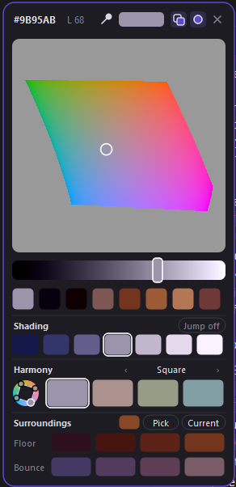

# Luma Picker

A floating color palette for digital painting on Windows, built around
**value**. Every color in the big field has the *same perceptual lightness*,
so you can change hue and saturation freely without breaking your values. It
also suggests shading colors, color harmonies and the shadow and bounce light
of an object's surroundings. Colors go straight into **Clip Studio Paint**.

## Features

- **Lightness-locked color field.** Pick any hue or saturation at one fixed
  value. The bar below changes the lightness. The grey around the colors is the
  neutral grey of the same value.
- **Shading** suggests 3 shadows and 3 lights for your color. Shadows get
  cooler, more saturated and darker. Lights get warmer, less saturated and
  lighter. Yellows darken through orange instead of turning green, and blues
  light up through cyan.
- **Harmony** offers complementary, split complementary, triad, square,
  tetradic and analogous schemes at the same lightness, with a mini color wheel.
- **Surroundings.** Pick the floor or background color and get:
  - **Floor:** the cast shadow, from the dark contact shadow under the object
    out to the soft edge.
  - **Bounce:** the surroundings reflected into the object's shadow side.
- **Eyedropper.** Pick any color on screen (canvas, references, Clip Studio's
  own color) into Luma, with the button or a hotkey.
- **Hex.** Click the hex code to copy it, or right-click it to paste one from
  the clipboard.
- **Floating panel.** Drag it by its top bar, pin it, keep it on top, or let it
  pop up under your pen with a hotkey. It works well on a macro pad
  (Razer Tartarus, Stream Deck, …).
- **Recent colors**, and settings that reload while the app runs.

## Download and install

1. Download `LumaPicker-<version>-windows.zip` from
   [Releases](../../releases/latest).
2. Unzip it anywhere, for example `Documents\Luma Picker`, and run
   **`Luma Picker.exe`**.
3. The panel opens and a rainbow ring icon appears in the system tray.

> **"Windows protected your PC"?** The app isn't code-signed yet, so
> SmartScreen warns about it. Click **More info → Run anyway**. You can check
> the source and build it yourself (see below).

## Set up Clip Studio Paint (once)

Luma Picker hands colors to Clip Studio through CSP's own screen picker:

1. In Clip Studio Paint open **File → Shortcut Settings**.
2. Choose **Menu commands → Edit → Pick screen color** (some versions call it
   *Obtain screen color*).
3. Click **Edit shortcut**, press **Ctrl+Alt+Shift+O** and click **OK**.

That's it. When you pick a color in Luma Picker, Clip Studio's drawing color
changes to match.

## Using it

| Do this | To |
|---|---|
| **Ctrl+Alt+Shift+C** | Show or hide the panel (under your pen, or at its pinned spot) |
| **Ctrl+Alt+Shift+E** | Eyedropper: click any color on screen to load it into Luma |
| Click or drag in the field, lift the pen | Send that color to Clip Studio |
| Drag the bar under the field | Change lightness |
| Click a recent, shading or harmony swatch | Send that color |
| **Jump on/off** (Shading) | On: the wheel moves to the shade you picked. Off: the rows stay put |
| **‹ name ›** (Harmony) | Switch the harmony scheme |
| **Pick / Current** (Surroundings) | Set the surface color from the screen or from the current color |
| Click / right-click the **hex** | Copy it / paste a hex from the clipboard |
| Drag the top bar | Move the panel (it stays there and stays open) |
| Two squares / circle / × (top right) | Stay on top / pin / close |

Map the two hotkeys to keys on your macro pad (for example in Razer Synapse)
for one-press access.

## Settings

Right-click the tray icon and choose **Open settings file**. The file is
`%APPDATA%\LumaPicker\settings.json` and changes apply right away, no restart
needed.

| Setting | Default | What it does |
|---|---|---|
| `hotkey` | `ctrl+alt+shift+c` | Show or hide the panel |
| `eyedropper_hotkey` | `ctrl+alt+shift+e` | Start the screen eyedropper (`""` to turn off) |
| `pick_shortcut` | `ctrl+alt+shift+o` | Must match the shortcut you gave *Pick screen color* in Clip Studio |
| `apply_mode` | `screen_pick` | `clipboard` only copies the hex instead of sending it to Clip Studio |
| `hue_shift_strength` | `1.0` | How strongly shading shifts hue (0.5 subtle, 2 strong) |
| `after_pick_shortcut` | `""` | A key to press after each pick, e.g. `"b"` to return to the brush |
| `picker_ready_ms` | `150` | Wait before clicking in Clip Studio's picker. Raise if colors sometimes don't arrive |
| `exit_delay_ms` | `90` | Pause before closing Clip Studio's picker |
| `flash_mode` | `dot` | `panel` flashes the whole panel instead of a small dot (fallback) |
| `auto_hide` / `auto_hide_distance` | `true` / `60` | Unpinned panel hides when the pen moves this far away |
| `also_copy_hex` | `false` | Also copy each picked color's hex |
| `debug_log` | `false` | Write timing info to `pick_log.txt` (for bug reports) |

Keys can be letters, digits, `f1`–`f24`, `numpad0`–`numpad9`, `space`, `tab`,
`insert`, `home`, … combined with `ctrl`, `alt`, `shift`, `win`.

## How it works (and limitations)

- **Windows only** for now: the global hotkeys and the hand-off to Clip Studio
  use the Windows API. On other systems it runs in clipboard mode.
- To send a color, Luma briefly shows a 9-pixel dot of the color under your
  pen, triggers Clip Studio's *Pick screen color* and clicks. The mouse is
  busy for about a third of a second.
- Other painting apps can work too if they have a "pick color from screen"
  command with a shortcut. Otherwise use `apply_mode: clipboard`.
- Tested with Clip Studio Paint on Windows.

## Privacy

Luma Picker has no network access, accounts, telemetry or ads. The
eyedropper's screen grab happens only while you're picking and never leaves
your PC. Settings and recent colors are stored in `%APPDATA%\LumaPicker\`.

## Run or build from source

You need [Python 3.10+](https://www.python.org/downloads/) with *"Add
python.exe to PATH"* ticked.

- **Run:** double-click `run.bat`. It installs `PySide6` and `numpy` the
  first time.
- **Build the .exe:** double-click `build.bat`. It runs the tests, builds
  `dist\Luma Picker\Luma Picker.exe` and can add a desktop shortcut.
- **Tests:** `python -m pytest tests`

Releases are built automatically by GitHub Actions (`.github/workflows/build.yml`)
when a version tag like `v1.0.0` is pushed, so every download matches the
source in this repository.

## License

MIT, see [LICENSE](LICENSE). Bundled libraries are listed in
[THIRD_PARTY_NOTICES.md](THIRD_PARTY_NOTICES.md).

Luma Picker is an independent project and is not affiliated with CELSYS
(Clip Studio Paint), Razer, or any hardware or software maker mentioned here.
